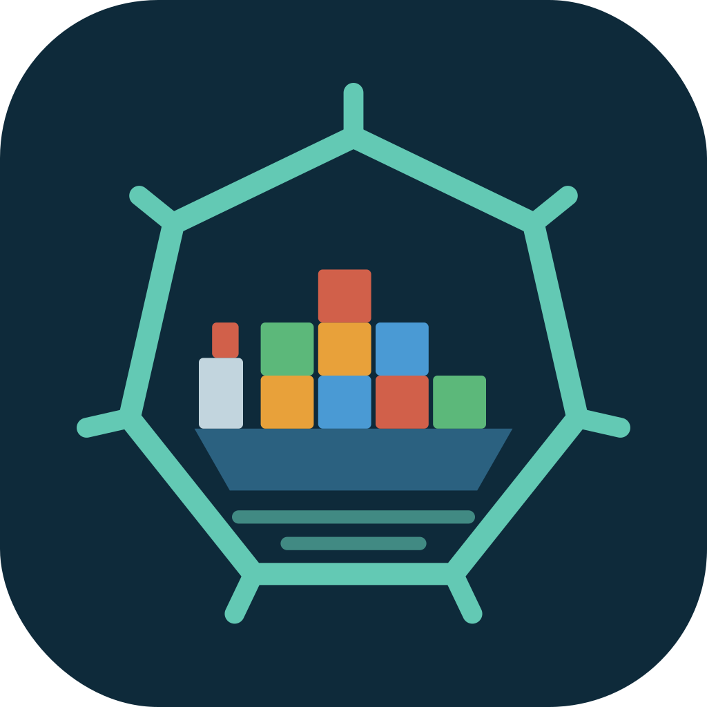

> [!IMPORTANT]
> **K8s Dockside has moved to [github.com/k8sdockside/k8sdockside](https://github.com/k8sdockside/k8sdockside).**
> The app, its releases, the container image (`ghcr.io/k8sdockside/k8sdockside`) and the Helm chart (`oci://ghcr.io/k8sdockside/helm/k8sdockside`) all live there now.
>
> This repository is now a **presentation about K8s Dockside**, nothing else.

<p align="center">
  
</p>

<h1 align="center">K8s Dockside: the presentation</h1>

<p align="center">
  The talk about <a href="https://github.com/k8sdockside/k8sdockside">K8s Dockside</a> at Cloud Native Trondheim, 17 November 2026: what it is, a live demo, and how it was built with AI agents.<br/>
  Built with <a href="https://sli.dev">Slidev</a>, shipped as a container image and a Helm chart. Live at <a href="https://k8sdockside.westerbo.no">k8sdockside.westerbo.no</a>.
</p>

<p align="center">
  <a href="https://github.com/rogerwesterbo/k8sdockside/actions/workflows/ci.yml"></a>
  <a href="https://github.com/rogerwesterbo/k8sdockside/actions/workflows/release.yml"></a>
  <a href="LICENSE"></a>
</p>

## Run it locally

Requires Node.js 22 or newer.

```bash
npm install
npm run dev       # http://localhost:3030  (presenter mode: /presenter)
npm run build     # static site in dist/
npm run export    # PDF export (uses playwright-chromium)
```

## Run it with Docker

The image builds the deck and serves it with [nginx-unprivileged](https://hub.docker.com/r/nginxinc/nginx-unprivileged) on port **8080**. It runs as a non-root user and works with a read-only root filesystem.

```bash
docker run --rm -p 8080:8080 ghcr.io/rogerwesterbo/k8sdockside-slides:latest

# or build it yourself
docker build -t k8sdockside-slides .
docker run --rm -p 8080:8080 k8sdockside-slides
```

## Deploy to Kubernetes with Helm

The chart is published as an OCI artifact to `oci://ghcr.io/rogerwesterbo/helm/k8sdockside-slides`.

```bash
helm install k8sdockside oci://ghcr.io/rogerwesterbo/helm/k8sdockside-slides \
  --version <version> \
  --namespace k8sdockside --create-namespace
kubectl -n k8sdockside port-forward svc/k8sdockside-k8sdockside-slides 8080:8080
```

To expose it through Gateway API (e.g. Envoy Gateway):

```yaml
httpRoute:
  enabled: true
  parentRefs:
    - name: eg
      namespace: envoy-gateway-system
      sectionName: https-k8sdockside
  hostnames:
    - k8sdockside.westerbo.no
```

An `ingress` block is there too. See [`charts/k8sdockside-slides/values.yaml`](charts/k8sdockside-slides/values.yaml) for every option. Set `imagePullSecrets` if the ghcr package is private.

## Releasing

Push a semver tag:

```bash
git tag v0.1.0
git push origin v0.1.0
```

The [release workflow](.github/workflows/release.yml) then:

1. Builds a multi-arch (`linux/amd64`, `linux/arm64`) image and pushes it to `ghcr.io/rogerwesterbo/k8sdockside-slides` with the tags `0.1.0`, `0.1`, `0` and `sha-<commit>`.
2. Packages the Helm chart with `version` and `appVersion` set to `0.1.0` and pushes it to `oci://ghcr.io/rogerwesterbo/helm`.

[CI](.github/workflows/ci.yml) runs on every push and pull request to `main`. It builds the deck, lints and renders the chart, and builds the image without pushing it.

## Repository layout

| Path | Contents |
| --- | --- |
| `slides.md` | The deck, with speaker notes and TODOs in `<!-- -->` comments |
| `global-top.vue`, `styles/`, `setup/mermaid.ts` | Logo overlay, the logo palette, and diagram colours |
| `public/` | Logos, avatar, plugin marks and QR codes |
| `Dockerfile`, `nginx/` | Container image and nginx config |
| `charts/k8sdockside-slides/` | Helm chart |
| `.github/workflows/` | CI and release pipelines |

## License

[Apache 2.0](LICENSE)
