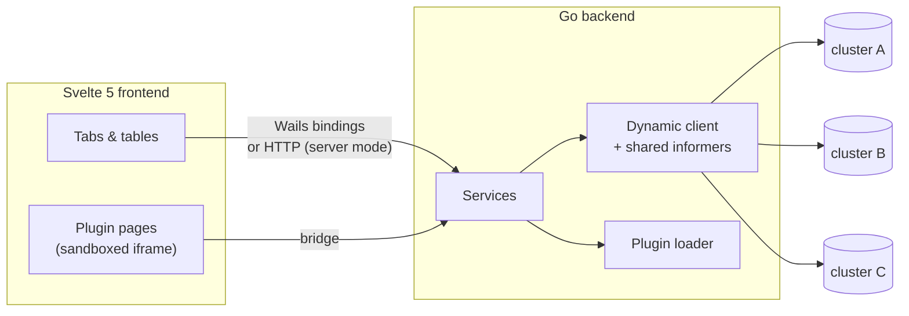
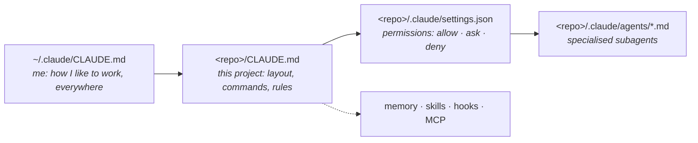

# K8s Dockside

<div class="text-xl opacity-80">
Every Kubernetes cluster you have, in one window
</div>

<div class="kd-stripe w-64 mx-auto mt-6"></div>

<div class="abs-bl m-8 flex items-center gap-4 text-left">
  
  <div>
    <div class="font-bold">Roger Westerbø</div>
    <div class="text-sm opacity-70">github.com/rogerwesterbo</div>
  </div>
</div>

---

# 📊 Quick poll, k8s tools

<div class="mt-8 text-2xl">
Go to <span class="kd-tag text-2xl">slido.com</span> and enter <b>6275003</b>
</div>

<!--
Multi-select poll in Slido. Switch to Slido to show the live results.

Expected: almost everyone kubectl, many k9s, a few Lens/Freelens/Headlamp.
K8s Dockside will probably get 0–1 votes: "Let's fix that tonight."

Point: there are more clients than kubectl, and each one makes different trade-offs.
-->

---

# What is K8s Dockside?

<div v-click>
Yet another Kubernetes client!
</div>

<div v-click>
Built with Wails 3, a Go backend, and a Svelte + TypeScript frontend.
</div>

<div class="relative mt-6" style="height: 330px">
  
  
  
</div>


---

# But why? 🤔

<div class="grid grid-cols-2 gap-10 mt-6">
<div>

<v-click>

### 😩

</v-click>

<v-clicks>

- 💸 Lens from Mirantis is too expensive
- ⛳️ K9s, FreeLens & HeadLamp shows one context at a time
- 🛑 Same tool on desktop as in web
- 🪟 Tab sorting (Lens, FreeLens) is bad..

</v-clicks>

</div>
<div>

<v-click>

### ☺️

</v-click>

<v-clicks>

- ❤️ Open Source
- 💶 Cheap
- 🧩 Plugins
- 🌈 Themes
- ⏰ Watches

</v-clicks>

</div>
</div>

<!--

-->

---

# Deployments? 💾


<div class="grid grid-cols-2 gap-8 mt-6">

<v-clicks>
<div class="kd-card">

### 🖥️ Desktop app

macOS, Windows and Linux

Reads the kubeconfigs on your machine. Your credentials never leave it.

</div>
<div class="kd-card">

### 🌐 Web app, in your cluster

Helm chart or plain manifests

Sign in with a local account, GitHub, Google, Microsoft, GitLab or any OIDC provider. Read-only by default.

</div>
</v-clicks>
</div>


<!--
test
-->

---

# How it fits together



<div class="text-sm opacity-70 mt-2">
One watch per kind, shared by every tab · everything goes through <code>unstructured</code> 
</div>

---

# 🎬 Live demo

<div class="grid grid-cols-2 gap-x-12 gap-y-3 text-left mt-8 max-w-3xl mx-auto">

<div>🗂️ Many clusters, names and colours</div>
<div>⚡ Live tables, CRDs, <kbd>⌘K</kbd> search</div>
<div>🧩 Installing a plugin</div>
<div class="flex items-center gap-2"> cert-manager</div>
<div class="flex items-center gap-2">💻 Show some plugins</div>
<div class="flex items-center gap-2"> Pixel agents 👾</div>

</div>

<!--
Demo checklist (cut Prometheus or cert-manager if you're behind on time):
1. Start page: cluster cards, local kind + hcloud cluster. Name/colour a context.
2. Pods table, live: scale a deployment and watch the rows change. Open a pod: logs, shell, YAML.
3. ⌘K search across clusters.
4. Settings → Plugins: install one.
5. cert-manager: certificates and their status.
6. Argo CD: applications, sync.
7. Prometheus charts on a node/pod.
8. Pixel agents: the cluster as a pixel-art office. Inspired by "Pixel Agents", which does the
   same for AI coding agents → good segue into the AI part.
-->

---

# 🤖 Let's build a plugin, live

<div class="grid grid-cols-[3fr_2fr] gap-8 mt-4">
<div>

**"kubectl panel"**: a panel on every pod, deployment and service that shows the `kubectl` commands for the object you're looking at

```sh
kubectl -n shop get deploy web -o yaml
kubectl -n shop describe deploy web
kubectl -n shop rollout restart deploy web
kubectl -n shop logs -f deploy/web
kubectl -n shop port-forward svc/web 8080:80
```

<div class="text-sm opacity-70 mt-2">
For everyone who voted <code>kubectl</code> in the poll 😉
</div>

</div>
<div class="kd-card text-sm">

### The prompt

> Create a K8s Dockside plugin in `../kubectl-panel` with a `sections` panel for pods, deployments and services that lists the equivalent kubectl commands for the object. Copy the layout of `../example-plugin` and check it with plugincheck.

<div class="mt-3 opacity-70">
plugin.json + one page · <code>plugin-author</code> agent · ~5 min
</div>

</div>
</div>

<!--
Run in Claude Code in the k8sdockside repo (so CLAUDE.md and the plugin-author agent are picked up).
Have a finished copy on a branch as a fallback if the network or the model is slow.

Bigger idea, for later: a log of the *actual* API requests the app makes, shown as kubectl commands.
That one can't be a plugin (plugin pages are sandboxed and never see the app's requests): it belongs
in the Go transport layer plus a dock tab, so it's a core feature, too big for a live demo.
-->

---

# 🌐 Same app, in the browser

<div class="grid grid-cols-[2fr_3fr] gap-8 mt-6 items-center">
<div>

```sh
helm install k8sdockside \
  oci://ghcr.io/k8sdockside/helm/k8sdockside \
  --namespace k8sdockside --create-namespace
```

</div>
<div>

- Same code, built with `-tags server`
- Sign in: local account, OAuth or OIDC
- Everyone acts with the **pod's** credentials
- The chart defaults to **read-only**

</div>
</div>

<!--
Just show that it works: open the web edition, sign in, click around for a minute.
-->

---

# The numbers

<div class="grid grid-cols-3 gap-6 mt-1 text-center">
<div class="kd-card"><div class="text-4xl font-bold text-[#62c8b4]">~1</div><div class="opacity-70">week<br/><span class="text-xs">for the POC</span></div></div>
  <div class="kd-card"><div class="text-4xl font-bold text-[#62c8b4]">~10</div><div class="opacity-70">weeks spent<br/><span class="text-xs">2 Sep → today</span></div></div>
  <div class="kd-card"><div class="text-4xl font-bold text-[#e8a23c]">~69k</div><div class="opacity-70">lines of Go</div></div>
  <div class="kd-card"><div class="text-4xl font-bold text-[#4a9bd4]">~74k</div><div class="opacity-70">lines of Svelte / TS</div></div>
  <div class="kd-card"><div class="text-4xl font-bold text-[#5cb87a]">200+</div><div class="opacity-70">test files</div></div>
  <div class="kd-card"><div class="text-4xl font-bold text-[#d4614c]">v0.1.41</div><div class="opacity-70">latest release</div></div>
  <div class="kd-card"><div class="text-4xl font-bold text-[#62c8b4]">25+</div><div class="opacity-70">plugin repos</div></div>
  <div class="kd-card"><div class="text-4xl font-bold text-[#62c8b4]">~100</div><div class="opacity-70">hours<br/><span class="text-xs">estimated from git</span></div></div>
  <div class="kd-card"><div class="text-4xl font-bold text-[#e8a23c]">~1.5B</div><div class="opacity-70">tokens<br/><span class="text-xs">98% cache re-reads</span></div></div>
</div>

<div class="mt-6 text-center opacity-70">
Mostly evenings and weekends.<br/>
≈ $500–1,000 at API prices, actually paid: ~$100–150 (my share of a $100/month Max plan)
</div>

<!--
Numbers from the repo on 12 Nov 2026; update them the day before.
- first commit 2026-09-02, 166 commits on main, commits on 42 different days
- Go: `git ls-files '*.go' | xargs cat | wc -l`
- frontend: svelte + ts under frontend/src
- hours: 324 commits across 27 repos, 43 days; commits <2h apart = one session, +30 min each (range 60–160h)
- tokens/$: measured 2–13 Nov from Claude Code logs (79M tokens, $33, 4.7h), extrapolated per hour
- Max share: monthly fee split by k8sdockside's share of my commits/usage
-->

---

# 📊 Quick poll, plugin suggestions 🧩

<div class="mt-8 text-2xl">
Go to <span class="kd-tag text-2xl">slido.com</span> and enter <b>6275003</b>
</div>

---

# How I work with Claude

<div class="grid grid-cols-2 gap-10 mt-4">
<div>

<v-click>

### 🧑‍💻 Me

</v-click>

<v-clicks>

- I decide how the app is built, and the **rules that must never break** ("Secret values are never cached")
- I write those rules down, so Claude knows them too
- I read every change, say **no** when it's wrong, and commit
- I decide when it's done: `make precheck` must pass, and perhaps more

</v-clicks>

</div>
<div>

<v-click>

### 🤖 Claude

</v-click>

<v-clicks>

- Writes the code, tests it, fixes it, and repeats
- Hands work to **helper agents** for Go, Svelte, docs and security review
- Runs builds and tests on its own, but only the ones I allow
- Asks me first before `kubectl`, `helm install` or `git push`

</v-clicks>

</div>
</div>

<!--
1. "Architecture and the invariants"

You decide how the app is put together: Go backend, shared informers, plugins in a sandboxed iframe, server mode with the pod's credentials. Claude doesn't make those decisions.

An invariant is a rule that must always hold, whatever feature is being built. It isn't a task, it's a boundary. In K8s Dockside, examples are:

Secret values never end up in a cache, a table, a log or a plugin page.
The kubeconfig is only ever read, never written.
No telemetry.
These are the rules an agent breaks without noticing. Ask it to "make the Secrets table faster" and the obvious fix is to cache Secrets in an informer like every other kind. That works, the tests pass, and you've broken a security promise. Only you know the rule is there, because it comes from why you built the app, not from the code.

2. "Writing them down so the agent can follow them"

Claude starts every session knowing nothing. A rule that only lives in your head doesn't exist for it. So you write the invariants into CLAUDE.md (the "Rules that are easy to break" section on your later slide) and into the agent files, like security-reviewer.md. Every session, and every subagent, reads them first.

That's the link to the later slides: point 1 is the thinking, and point 2 is what CLAUDE.md and .claude/agents/ are for.

If the wording feels unclear, plainer versions could be:

The architecture, and the rules that must never break ("Secrets never reach a cache")
Writing those rules into CLAUDE.md, because the agent can't follow rules it hasn't been told
-->

---

# Where Claude Code gets its context



<div class="text-sm opacity-70 text-center">
Checked into git: the whole team (and every agent) gets the same rules
</div>

---

# `<repo>/CLAUDE.md`: the rules that are easy to break

```md {all|5|8-9|10|16|all}
# K8s Dockside

## Rules that are easy to break

- **Build both tags.**
- **`frontend/bindings/` is generated.** Never edit it.
- **Everything goes through the dynamic client.**
- **Secrets are redacted before they are cached.**
- **The kubeconfig is read, never written.**
- **No telemetry, and no network calls the user didn't ask for.**
- **Plugins are strict.**
- **Server mode defaults to read-only.**

## Commands

make precheck   # everything CI runs. Run it before saying "done".
```

<div class="text-sm opacity-70 text-center mt-2">
The real file is ~70 lines: layout, commands, these rules (each with a short <i>why</i>), style
</div>

<!--
The rule headlines from github.com/k8sdockside/k8sdockside/CLAUDE.md, word for word.
In the file, each rule has a sentence or two saying why, e.g.:
  "Secrets are redacted before they are cached. Only the editor reads a Secret live."
  "Build both tags. Code that compiles without -tags server can still fail with it, and the reverse."
Point: short and specific. Not documentation of everything: it links to docs/ for the rest.
Optional: open the real file in the editor.
-->

---

# Memory, skills, hooks & MCP

<div class="grid grid-cols-2 gap-3 kd-extras">

<div v-click class="kd-card">

### 🧠 Memory <span class="kd-tag">Claude writes it</span>

What Claude learnt, kept for next time

<div class="kd-path">📁 ~/.claude/projects/…/memory/project_k8sdockside_frontend_workflow.md</div>

```md
---
name: k8sdockside-frontend-workflow
type: project
---
frontend/bindings/ is generated: regenerate
after every Go API change, or the TS types lag.
**Why:** it cost a whole session to rediscover.
```

</div>

<div v-click class="kd-card">

### 📚 Skills <span class="kd-tag">read when relevant</span>

A how-to, loaded only when the task matches

<div class="kd-path">📁 superpowers plugin › skills/test-driven-development/SKILL.md</div>

```md
---
name: test-driven-development
description: Use when implementing any feature
  or bugfix, before writing implementation code
---
Write the test first. Watch it fail.
Write minimal code to pass.
```

</div>

<div v-click class="kd-card">

### 🪝 Hooks <span class="kd-tag">always runs</span>

A script the app runs, not something Claude has to remember

<div class="kd-path">📁 security-guidance plugin › hooks/hooks.json</div>

```json
"PostToolUse": [{
  "matcher": "Edit|Write",
  "hooks": [{ "type": "command",
    "command": "security_reminder_hook.py" }]
}]
```

</div>

<div v-click class="kd-card">

### 🔌 MCP <span class="kd-tag">new tools</span>

Lets Claude use other systems: issues, PRs, CI

<div class="kd-path">📁 github plugin › .mcp.json</div>

```json
"github": {
  "type": "http",
  "url": "https://api.githubcopilot.com/mcp/"
}
```

</div>

</div>

<style>
.kd-extras.grid > .kd-card { padding: 0.5rem 0.85rem; }
.kd-extras h3 { font-size: 1rem; margin: 0; }
.kd-extras p { font-size: 0.75rem; opacity: 0.75; margin: 0 0 0.15rem; }
.kd-extras .kd-path { font-family: var(--slidev-code-font-family, monospace); font-size: 0.55rem; color: var(--kd-teal); margin-bottom: 0.25rem; white-space: nowrap; }
.kd-extras .slidev-code { font-size: 0.58rem !important; line-height: 1.3 !important; padding: 0.4rem 0.6rem !important; margin: 0 !important; }
</style>

<!--
All four are real, from my own setup (shortened):
- Memory: ~/.claude/projects/<project>/memory/*.md. Claude writes these itself when something cost
  time, or when I say "remember". An index (MEMORY.md) is loaded every session.
  Private to my machine. CLAUDE.md is the rules I write and share; memory is Claude's own notebook.
- Skills: from the superpowers plugin (skills/test-driven-development/SKILL.md). Only the
  description is always in context; the rest is read when the task matches it. That's how you
  can have dozens without filling the context.
- Hooks: from the security-guidance plugin (hooks/hooks.json). After every Edit/Write, a script
  checks the change for security patterns. Point: CLAUDE.md is a request, a hook is enforced.
- MCP: the github plugin's .mcp.json. Token comes from an env var, never in the file.

Where your own go (no plugin needed):
- Skills: ~/.claude/skills/<name>/SKILL.md (you) or <repo>/.claude/skills/<name>/SKILL.md (team)
- Hooks: "hooks" in ~/.claude/settings.json or <repo>/.claude/settings.json
- MCP: <repo>/.mcp.json (team) or `claude mcp add` (you)
- Memory: Claude writes it; you don't create it by hand (but you can edit or delete it)

One-liner: CLAUDE.md = always read · skill = read when it fits · hook = always runs · MCP = new tools.

Don't show the other memory files: they name my clusters and kubeconfigs.
The cilium memory is a good story to tell out loud ("Claude broke my cluster, now it's written down").
-->

---

# `<repo>/.claude/settings.json`: what it may do alone

```json {all|3-10|11-17|18-23}{maxHeight:'400px'}
{
  "permissions": {
    "allow": [
      "Bash(make build-go)",
      "Bash(make test)",
      "Bash(make lint)",
      "Bash(make precheck)",
      "Bash(go test *)",
      "Bash(git diff *)"
    ],
    "ask": [
      "Bash(kubectl *)",
      "Bash(helm install *)",
      "Bash(git push *)",
      "Bash(git tag *)",
      "Bash(npm publish *)"
    ],
    "deny": [
      "Read(./.env)",
      "Read(~/.kube/**)",
      "Edit(./frontend/bindings/**)",
      "Write(./frontend/dist/**)"
    ]
  }
}
```

<!--
Shortened from the real file. allow = no prompt, ask = always prompt, deny = never.
Note: deny Read(~/.kube/**): the agent never sees my cluster credentials.
-->

---

# `<repo>/.claude/agents/`: a team of specialists

<div class="grid grid-cols-2 gap-6 mt-2">
<div class="text-sm whitespace-nowrap">

| Agent               | Model   | Writes?      |
| ------------------- | ------- | ------------ |
| `go-backend`        | default | ✅           |
| `svelte-frontend`   | default | ✅           |
| `plugin-author`     | default | ✅           |
| `docs-writer`       | sonnet  | ✅ docs      |
| `security-reviewer` | opus    | ❌ read-only |

</div>
<div>

```md
---
name: security-reviewer
description: Read-only security review of a
  K8s Dockside change against the app's own
  guarantees (Secret redaction, kubeconfig
  never written, no telemetry, plugin sandbox,
  server-mode auth, Helm chart RBAC).
tools: Read, Grep, Glob, Bash
model: opus
---

You review changes. You do not edit files.
```

</div>
</div>

<!--
Each agent has its own context window, tools and instructions. The main session delegates to them.
The reviewer can't edit: it has to convince me, not just change the code.
-->

---

# 🎓 Learn it properly: Anthropic Academy

<div class="grid grid-cols-2 gap-6 mt-6">
  <div class="kd-card">🧭 <b>AI Fluency</b><br/><span class="text-sm opacity-70">How to work with AI, not just prompt it</span></div>
  <div class="kd-card">⌨️ <b>Claude Code in Action</b><br/><span class="text-sm opacity-70">Context, CLAUDE.md, subagents</span></div>
  <div class="kd-card">🔌 <b>Introduction to MCP</b><br/><span class="text-sm opacity-70">Model Context Protocol: tools for agents</span></div>
  <div class="kd-card">🛠️ <b>Building with the Claude API</b><br/><span class="text-sm opacity-70">When you build AI into your own apps</span></div>
</div>

<div class="mt-8 text-center">
Free: <b>anthropic.skilljar.com</b> · docs: <b>docs.claude.com</b>
</div>

<!--
TODO: check the course list on anthropic.skilljar.com the day before and say which ones you took.
-->

---

# 🏠 Local LLMs

<div class="grid grid-cols-[1fr_1fr] gap-8 mt-2">
<div>

<v-click>

### My setup

- **LM Studio** on a MacBook M5 Pro, 48 GB
- **Qwen3.6-35B-A3B**, 4-bit MLX (~20 GB)

```sh
M=qwen3.6-35b-a3b        # name from `lms ls`
lms server start
lms load $M -c 65536     # context, default is small
export ANTHROPIC_BASE_URL=http://localhost:1234
export ANTHROPIC_AUTH_TOKEN=lmstudio
export ANTHROPIC_DEFAULT_HAIKU_MODEL=$M
claude --model $M
```

<div class="text-sm opacity-70">Same Claude Code, different brain</div>
<div class="text-sm opacity-70">..or use <a href="https://opencode.ai/" target="_blank">OpenCode</a>, <a href="https://omp.sh"  target="_blank">omp.sh</a> or <a href="https://cline.bot/"  target="_blank">Cline</a></div>


</v-click>

</div>
<div class="text-sm">

<v-click>

### 👍 Good, because

</v-click>

<v-clicks>

- **Private:** code and prompts never leave the laptop
- **Free and offline:** no token bill, works on a plane
- **Fast enough:** MoE, only 3B of the 35B weights work per token

</v-clicks>

<v-click>

### 👎 Not there (yet), because

</v-click>

<v-clicks>

- **Smaller brain:** squeezed to 4 bits to fit in RAM, so it knows less and reasons worse than frontier models
- **Errors add up:** an agent makes 50+ tool calls, so small mistakes pile up and it loses the thread
- **RAM is the ceiling:** the weights and the context share it, so the context is shorter and long prompts are slow

</v-clicks>

</div>
</div>

<v-click>

<div class="mt-4 text-center kd-card">
Local for small, private tasks. Claude for building K8s Dockside.
</div>

</v-click>

<!--
TODO: adjust the pros/cons to what you actually saw, and add a real number:
tokens/sec in LM Studio for Qwen3.6-35B-A3B on the M5 Pro (shown under the chat while it answers).

LM Studio has an Anthropic-compatible endpoint, so Claude Code can talk to it
with just ANTHROPIC_BASE_URL. Ollama works the same way (port 11434).

Why each line:
- --model: Claude Code sends a model name with every request, it must match the key in `lms ls`.
- lms load -c: LM Studio would auto-load (JIT) on the first request, but with its default context length.
  Claude Code's system prompt + tools alone are tens of thousands of tokens.
- ANTHROPIC_DEFAULT_HAIKU_MODEL: Claude Code also makes small background calls on the "haiku" model,
  which LM Studio doesn't have. ANTHROPIC_DEFAULT_SONNET_MODEL / _OPUS_MODEL do the same for subagents (Explore).
- Optional: CLAUDE_CODE_MAX_CONTEXT_TOKENS=65536 (tell Claude Code the real window),
  CLAUDE_CODE_ATTRIBUTION_HEADER=0 (LM Studio's docs recommend it).

MoE (mixture of experts): all 35B weights must fit in memory, but a router picks
a few "experts" per token, ~3B parameters, so it runs like a small model and knows like a bigger one.

4-bit: each weight is stored in 4 bits instead of 16, so ~4x smaller, at some cost in quality.
-->

---

# ⚠️ A model file can run code

<div class="grid grid-cols-2 gap-6 mt-4">

<v-click>

<div class="kd-card text-sm">

### 🤗 Hugging Face

- **2024:** ~100 models with hidden payloads, one opened a reverse shell <span class="opacity-60">(JFrog)</span>
- **2025:** "nullifAI", broken pickle files that slipped past HF's own scanner <span class="opacity-60">(ReversingLabs)</span>

<div class="text-sm opacity-70 mt-2">Pickle = Python objects, loading one can run any code</div>

</div>

</v-click>

<v-click>

<div class="kd-card text-sm">

### 🐳 Docker Model Runner

- **CVE-2026-28400:** no-auth API, any container could overwrite files on the host
- **CVE-2026-5843:** an MLX model's `config.json` could run Python on your Mac

<div class="text-sm opacity-70 mt-2">safetensors are safe, the files next to them may not be</div>

</div>

</v-click>

</div>

<v-click>

<h3 class="mt-6">What I do</h3>

</v-click>

<v-clicks>

- Known publishers (`mlx-community`, `lmstudio-community`), safetensors or GGUF, never pickle
- Keep the runtime updated, and keep its API on `localhost`
- Let AI write a `~/update.sh` and run it every morning: macOS, brew, Docker, Go, Node, VS Code
- Treat a model like any other dependency: it's code from the internet

</v-clicks>

<!--
Sources:
- JFrog, Feb 2024: ~100 malicious models on Hugging Face, PyTorch pickle __reduce__ payloads, one reverse shell to a real IP.
- ReversingLabs, Feb 2025, "nullifAI": 7z-compressed, deliberately broken pickles. Picklescan failed on them and so never flagged them,
  but Python still ran the payload before hitting the broken part. HF removed them within 24h and fixed Picklescan.
- Docker Model Runner CVE-2026-28400 (Feb 2026, fixed in DMR 1.0.16 / Desktop 4.61): POST /engines/_configure took
  llama.cpp flags without auth, --log-file could overwrite any file. Reachable from any container.
- CVE-2026-5843 (May 2026, fixed in Desktop 4.71): the MLX backend uses MLX-LM, which loads the Python file named by
  "model_file" in config.json, no trust_remote_code check, no sandbox. Same month CVE-2026-5817: the vllm-metal backend
  always set trust_remote_code=True.
  LM Studio's MLX engine is also built on MLX-LM: keep it updated.
- Bonus: "DockerDash" (Noma, fixed in Desktop 4.50, Nov 2025): instructions hidden in a Docker image LABEL made
  Ask Gordon (Docker's AI assistant) run commands through MCP tools. Prompt injection: the same risk for every agent.
-->

---

# What I've learnt

<v-clicks>

- 🐘 **Eat the elephant one bite at a time**: AI still struggles with big problems, but is great at small ones
- ✍️ **Write your rules down**: Claude can't follow a rule that's only in your head
- 🔁 **Small steps, and test every step**: (plan, ) implement, test, `make precheck` (build, test, lint, etc)
- 🧑‍⚖️ **Read the change**: sounding sure is not the same as being right
- 🔒 **Don't let the agent do everything**: allow some things, ask for others, block the rest
- 🚀 **Experience matters more, not less**: knowing what to build, and when to say no

</v-clicks>

<!--
TODO: adjust to your own experience. Add the "what went wrong" story here if it's not on the earlier slide.
-->


---

# 📊 Quick feedback poll

<div class="mt-8 text-2xl">
Go to <span class="kd-tag text-2xl">slido.com</span> and enter <b>6275003</b>
</div>

<!--
Multi-select poll in Slido. Switch to Slido to show the live results.

Expected: almost everyone kubectl, many k9s, a few Lens/Freelens/Headlamp.
K8s Dockside will probably get 0–1 votes: "Let's fix that tonight."

Point: there are more clients than kubectl, and each one makes different trade-offs.
-->


---


# Questions? 🙋 <br />

Or just thanks for letting me presentate 🖖

<div class="mt-8 grid grid-cols-2 gap-12 max-w-3xl mx-auto text-left">
<div class="flex gap-4 items-center">
  
  <div class="text-sm">
    <b>Get K8s Dockside</b><br/>
    github.com/k8sdockside/k8sdockside<br/>
    <ul>
    <li>MacOS</li>
    <li>Windows</li>
    <li>Linux</li>
    <li>Helm (OCI package)</li>
    </ul>
  </div>
</div>
<div class="flex gap-4 items-center">
  
  <div class="text-sm">
    <b>These slides</b><br/>
    k8sdockside.westerbo.no
  </div>
</div>
</div>

<!-- <div class="mt-8 text-sm">

```sh
helm install k8sdockside oci://ghcr.io/k8sdockside/helm/k8sdockside -n k8sdockside --create-namespace
```

</div> -->

<div class="mt-4 flex items-center justify-center gap-3 opacity-80 text-sm">
   Roger Westerbø
</div>
