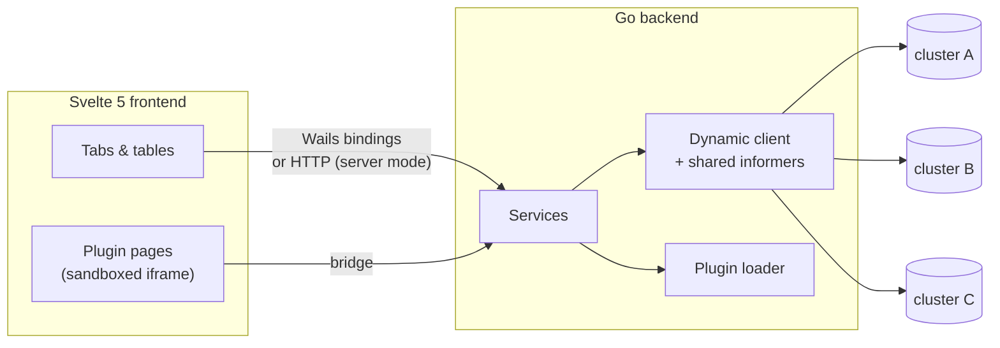
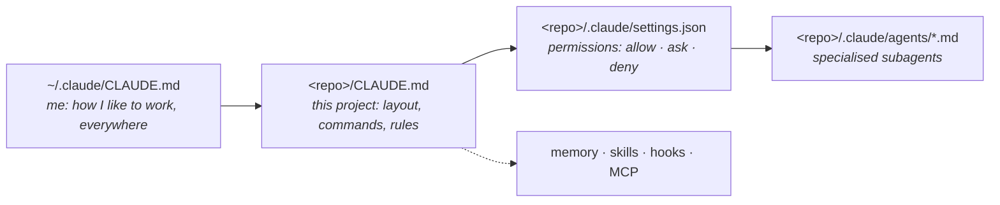

# K8s Dockside

<div class="text-xl opacity-80">
Every Kubernetes cluster you have, in one window
</div>

<div class="kd-stripe w-64 mx-auto mt-6"></div>

<div class="abs-bl m-8 flex items-center gap-4 text-left">
  
  <div>
    <div class="font-bold">Roger Westerbø</div>
    <div class="text-sm opacity-70">github.com/rogerwesterbo</div>
  </div>
</div>

---

# 📊 Quick poll

<div class="mt-8 text-2xl">
Go to <span class="kd-tag text-2xl">slido.com</span> and enter <b>6275003</b>
</div>

<!--
Multi-select poll in Slido. Switch to Slido to show the live results.

Expected: almost everyone kubectl, many k9s, a few Lens/Freelens/Headlamp.
K8s Dockside will probably get 0–1 votes: "Let's fix that tonight."

Point: there are more clients than kubectl, and each one makes different trade-offs.
-->

---

# But why? 🤔

<div class="grid grid-cols-2 gap-10 mt-6">
<div>

### 😩

<v-clicks>

- 💸 Lens from Mirantis is too expensive
- ⛳️ K9s, FreeLens & HeadLamp shows one context at a time
- 🛑 Same tool on desktop as in web
- 🪟 Tab sorting (Lens, FreeLens) is bad..

</v-clicks>

</div>
<div>

### ☺️

<v-clicks>

- ❤️ Open Source
- 💶 Cheap
- 🧩 Plugins
- 🌈 Themes
- ⏰ Watches

</v-clicks>

</div>
</div>

<!--

-->

---

# What is K8s Dockside?

Yet another Kubernetes client!

<div v-click>
Built with Wails 3, a Go backend, and a Svelte + TypeScript frontend.
</div>

<div class="relative mt-6" style="height: 330px">
  
  
  
</div>


---

# Deployments? 💾


<div class="grid grid-cols-2 gap-8 mt-6">

<v-clicks>
<div class="kd-card">

### 🖥️ Desktop app

macOS, Windows and Linux

Reads the kubeconfigs on your machine. Your credentials never leave it.

</div>
<div class="kd-card">

### 🌐 Web app, in your cluster

Helm chart or plain manifests

Sign in with a local account, GitHub, Google, Microsoft, GitLab or any OIDC provider. Read-only by default.

</div>
</v-clicks>
</div>


<!--
test
-->

---

# How it fits together



<div class="text-sm opacity-70 mt-2">
One watch per kind, shared by every tab · everything goes through <code>unstructured</code> 
</div>

---

# 🎬 Live demo

<div class="grid grid-cols-2 gap-x-12 gap-y-3 text-left mt-8 max-w-3xl mx-auto">

<div>🗂️ Many clusters, names and colours</div>
<div>⚡ Live tables, CRDs, <kbd>⌘K</kbd> search</div>
<div>🧩 Installing a plugin</div>
<div class="flex items-center gap-2"> cert-manager</div>
<div class="flex items-center gap-2"> Argo CD</div>
<div class="flex items-center gap-2"> Prometheus metrics</div>
<div class="flex items-center gap-2"> Pixel agents 👾</div>

</div>

<!--
Demo checklist (cut Prometheus or cert-manager if you're behind on time):
1. Start page: cluster cards, local kind + hcloud cluster. Name/colour a context.
2. Pods table, live: scale a deployment and watch the rows change. Open a pod: logs, shell, YAML.
3. ⌘K search across clusters.
4. Settings → Plugins: install one.
5. cert-manager: certificates and their status.
6. Argo CD: applications, sync.
7. Prometheus charts on a node/pod.
8. Pixel agents: the cluster as a pixel-art office. Inspired by "Pixel Agents", which does the
   same for AI coding agents → good segue into the AI part.
-->

---

# 🤖 Let's build a plugin, live

<div class="grid grid-cols-[3fr_2fr] gap-8 mt-4">
<div>

**"kubectl panel"**: a panel on every pod, deployment and service that shows the `kubectl` commands for the object you're looking at

```sh
kubectl -n shop get deploy web -o yaml
kubectl -n shop describe deploy web
kubectl -n shop rollout restart deploy web
kubectl -n shop logs -f deploy/web
kubectl -n shop port-forward svc/web 8080:80
```

<div class="text-sm opacity-70 mt-2">
For everyone who voted <code>kubectl</code> in the poll 😉
</div>

</div>
<div class="kd-card text-sm">

### The prompt

> Create a K8s Dockside plugin in `../kubectl-panel` with a `sections` panel for pods, deployments and services that lists the equivalent kubectl commands for the object. Copy the layout of `../example-plugin` and check it with plugincheck.

<div class="mt-3 opacity-70">
plugin.json + one page · <code>plugin-author</code> agent · ~5 min
</div>

</div>
</div>

<!--
Run in Claude Code in the k8sdockside repo (so CLAUDE.md and the plugin-author agent are picked up).
Have a finished copy on a branch as a fallback if the network or the model is slow.

Bigger idea, for later: a log of the *actual* API requests the app makes, shown as kubectl commands.
That one can't be a plugin (plugin pages are sandboxed and never see the app's requests): it belongs
in the Go transport layer plus a dock tab, so it's a core feature, too big for a live demo.
-->

---

# 🌐 Same app, in the browser

<div class="grid grid-cols-[2fr_3fr] gap-8 mt-6 items-center">
<div>

```sh
helm install k8sdockside \
  oci://ghcr.io/k8sdockside/helm/k8sdockside \
  --namespace k8sdockside --create-namespace
```

</div>
<div>

- Same code, built with `-tags server`
- Sign in: local account, OAuth or OIDC
- Everyone acts with the **pod's** credentials
- The chart defaults to **read-only**

</div>
</div>

<!--
Just show that it works: open the web edition, sign in, click around for a minute.
-->

---

# The numbers

<div class="grid grid-cols-3 gap-6 mt-1 text-center">
<div class="kd-card"><div class="text-4xl font-bold text-[#62c8b4]">~1</div><div class="opacity-70">week<br/><span class="text-xs">for the POC</span></div></div>
  <div class="kd-card"><div class="text-4xl font-bold text-[#62c8b4]">~10</div><div class="opacity-70">weeks spent<br/><span class="text-xs">2 Sep → today</span></div></div>
  <div class="kd-card"><div class="text-4xl font-bold text-[#e8a23c]">~69k</div><div class="opacity-70">lines of Go</div></div>
  <div class="kd-card"><div class="text-4xl font-bold text-[#4a9bd4]">~74k</div><div class="opacity-70">lines of Svelte / TS</div></div>
  <div class="kd-card"><div class="text-4xl font-bold text-[#5cb87a]">200+</div><div class="opacity-70">test files</div></div>
  <div class="kd-card"><div class="text-4xl font-bold text-[#d4614c]">v0.1.41</div><div class="opacity-70">latest release</div></div>
  <div class="kd-card"><div class="text-4xl font-bold text-[#62c8b4]">25+</div><div class="opacity-70">plugin repos</div></div>
  <div class="kd-card"><div class="text-4xl font-bold text-[#62c8b4]">~100</div><div class="opacity-70">hours<br/><span class="text-xs">estimated from git</span></div></div>
  <div class="kd-card"><div class="text-4xl font-bold text-[#e8a23c]">~1.5B</div><div class="opacity-70">tokens<br/><span class="text-xs">98% cache re-reads</span></div></div>
</div>

<div class="mt-6 text-center opacity-70">
Mostly evenings and weekends.<br/>
≈ $500–1,000 at API prices, actually paid: ~$100–150 (my share of a $100/month Max plan)
</div>

<!--
Numbers from the repo on 12 Nov 2026; update them the day before.
- first commit 2026-09-02, 166 commits on main, commits on 42 different days
- Go: `git ls-files '*.go' | xargs cat | wc -l`
- frontend: svelte + ts under frontend/src
- hours: 324 commits across 27 repos, 43 days; commits <2h apart = one session, +30 min each (range 60–160h)
- tokens/$: measured 2–13 Nov from Claude Code logs (79M tokens, $33, 4.7h), extrapolated per hour
- Max share: monthly fee split by k8sdockside's share of my commits/usage
-->

---

# 📊 Quick poll, plugin suggestions 🧩

<div class="mt-8 text-2xl">
Go to <span class="kd-tag text-2xl">slido.com</span> and enter <b>6275003</b>
</div>

---

# How I work with Claude

<div class="grid grid-cols-2 gap-10 mt-4">
<div>

### 🧑‍💻 Me

<v-clicks>

- Architecture and the **invariants** ("Secrets never reach a cache")
- Writing them down so the agent can follow them
- Reviewing the diff, saying **no**, and committing
- Knowing what "done" looks like: `make precheck`

</v-clicks>

</div>
<div>

### 🤖 Claude

<v-clicks>

- (Plan →) implement → test, in loops
- Specialised **subagents** for Go, Svelte, docs and security review
- Runs builds, linters and tests by itself (allowed list)
- Asks before `kubectl`, `helm install` or `git push`

</v-clicks>

</div>
</div>

<!--
TODO: one story where Claude got it wrong (e.g. a "simplification" that broke an invariant),
and what you put in CLAUDE.md / an agent afterwards so it didn't happen again.
-->

---

# 🎓 Learn it properly: Anthropic Academy

<div class="grid grid-cols-2 gap-6 mt-6">
  <div class="kd-card">🧭 <b>AI Fluency</b><br/><span class="text-sm opacity-70">How to work with AI, not just prompt it</span></div>
  <div class="kd-card">⌨️ <b>Claude Code in Action</b><br/><span class="text-sm opacity-70">Context, CLAUDE.md, hooks, subagents</span></div>
  <div class="kd-card">🔌 <b>Introduction to MCP</b><br/><span class="text-sm opacity-70">Model Context Protocol: tools for agents</span></div>
  <div class="kd-card">🛠️ <b>Building with the Claude API</b><br/><span class="text-sm opacity-70">When you build AI into your own apps</span></div>
</div>

<div class="mt-8 text-center">
Free: <b>anthropic.skilljar.com</b> · docs: <b>docs.claude.com</b>
</div>

<!--
TODO: check the course list on anthropic.skilljar.com the day before and say which ones you took.
-->

---

# Where Claude Code gets its context



<div class="text-sm opacity-70 text-center">
Checked into git: the whole team (and every agent) gets the same rules
</div>

---

# `CLAUDE.md`: the rules that are easy to break

```md {all|4-5|6|7-8|all}{maxHeight:'380px'}
# K8s Dockside

## Rules that are easy to break

- **Build both tags.** Code that compiles without `-tags server`
  can still fail with it, and the reverse.
- **`frontend/bindings/` is generated.** Never edit it. Run `make generate`.
- **Secrets are redacted before they are cached.** Never add a path that
  puts Secret values into an informer cache, a table, a log or a plugin page.
- **The kubeconfig is read, never written.**
- **No telemetry, and no network calls the user didn't ask for.**
- **Plugins are strict.** Unknown manifest fields are errors, not warnings.
- **Server mode defaults to read-only.** Chart defaults must stay safe.

## Commands

make precheck # everything CI runs. Run it before saying "done".
```

<!--
Real excerpt from k8sdockside/CLAUDE.md. Point: short, specific, the *why* behind the rules.
Not documentation of everything: links to docs/ for the rest.
Optional: open the real file in the editor.
-->

---

# `.claude/settings.json`: what it may do alone

```json {all|3-10|11-17|18-23}{maxHeight:'400px'}
{
  "permissions": {
    "allow": [
      "Bash(make build-go)",
      "Bash(make test)",
      "Bash(make lint)",
      "Bash(make precheck)",
      "Bash(go test *)",
      "Bash(git diff *)"
    ],
    "ask": [
      "Bash(kubectl *)",
      "Bash(helm install *)",
      "Bash(git push *)",
      "Bash(git tag *)",
      "Bash(npm publish *)"
    ],
    "deny": [
      "Read(./.env)",
      "Read(~/.kube/**)",
      "Edit(./frontend/bindings/**)",
      "Write(./frontend/dist/**)"
    ]
  }
}
```

<!--
Shortened from the real file. allow = no prompt, ask = always prompt, deny = never.
Note: deny Read(~/.kube/**): the agent never sees my cluster credentials.
-->

---

# `.claude/agents/`: a team of specialists

<div class="grid grid-cols-2 gap-6 mt-2">
<div class="text-sm whitespace-nowrap">

| Agent               | Model   | Writes?      |
| ------------------- | ------- | ------------ |
| `go-backend`        | default | ✅           |
| `svelte-frontend`   | default | ✅           |
| `plugin-author`     | default | ✅           |
| `docs-writer`       | sonnet  | ✅ docs      |
| `security-reviewer` | opus    | ❌ read-only |

</div>
<div>

```md
---
name: security-reviewer
description: Read-only security review of a
  K8s Dockside change against the app's own
  guarantees (Secret redaction, kubeconfig
  never written, no telemetry, plugin sandbox,
  server-mode auth, Helm chart RBAC).
tools: Read, Grep, Glob, Bash
model: opus
---

You review changes. You do not edit files.
```

</div>
</div>

<!--
Each agent has its own context window, tools and instructions. The main session delegates to them.
The reviewer can't edit: it has to convince me, not just change the code.
-->

---

# What I've learnt

<v-clicks>

- ✍️ **Write down the invariants**: the agent can't respect a rule that lives in your head
- 🔁 **Small loops with a hard check**: tests, lint, `make precheck`
- 🧑‍⚖️ **Review like it's a colleague's PR**: confident is not the same as correct
- 🔒 **Least privilege for agents too**: allow, ask, deny
- 🚀 **Seniority matters more, not less**: knowing what to build, and what to say no to

</v-clicks>

<!--
TODO: adjust to your own experience. Add the "what went wrong" story here if it's not on the earlier slide.
-->

---


# Questions? 🙋 <br />

Or just thanks for letting me presentate 🖖

<div class="mt-8 grid grid-cols-2 gap-12 max-w-3xl mx-auto text-left">
<div class="flex gap-4 items-center">
  
  <div class="text-sm">
    <b>Get K8s Dockside</b><br/>
    github.com/k8sdockside/k8sdockside<br/>
    <ul>
    <li>MacOS</li>
    <li>Windows</li>
    <li>Linux</li>
    <li>Helm (OCI package)</li>
    </ul>
  </div>
</div>
<div class="flex gap-4 items-center">
  
  <div class="text-sm">
    <b>These slides</b><br/>
    k8sdockside.westerbo.no
  </div>
</div>
</div>

<!-- <div class="mt-8 text-sm">

```sh
helm install k8sdockside oci://ghcr.io/k8sdockside/helm/k8sdockside -n k8sdockside --create-namespace
```

</div> -->

<div class="mt-4 flex items-center justify-center gap-3 opacity-80 text-sm">
   Roger Westerbø
</div>
